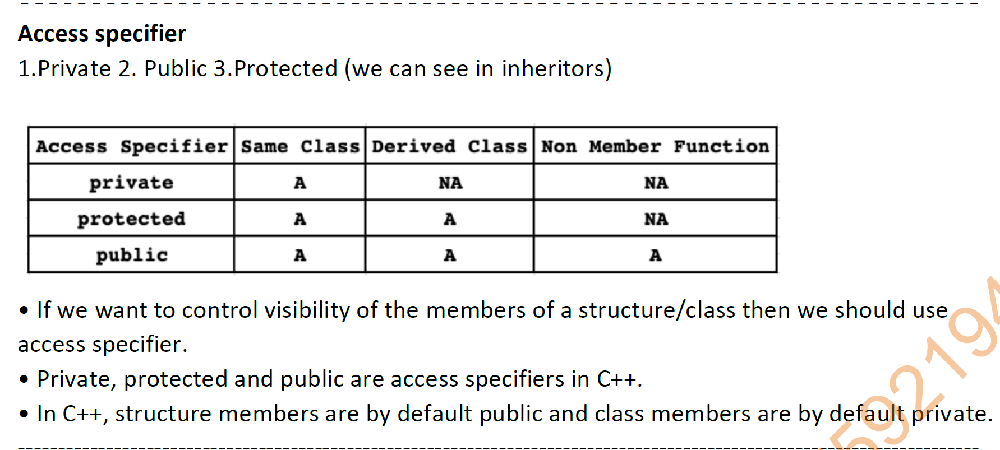
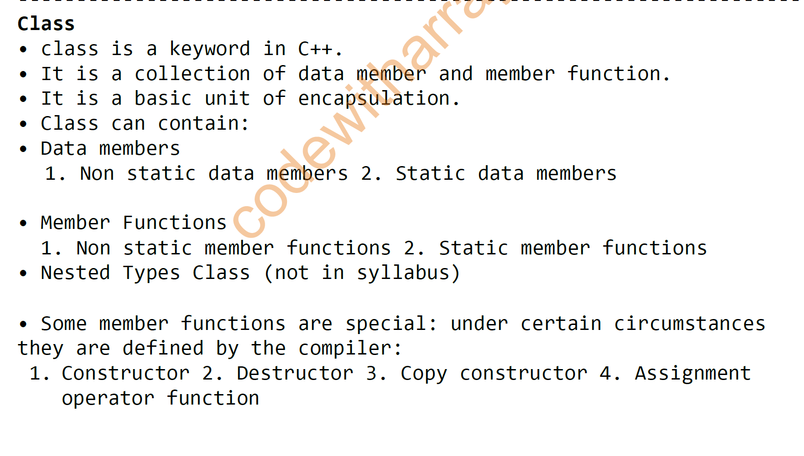
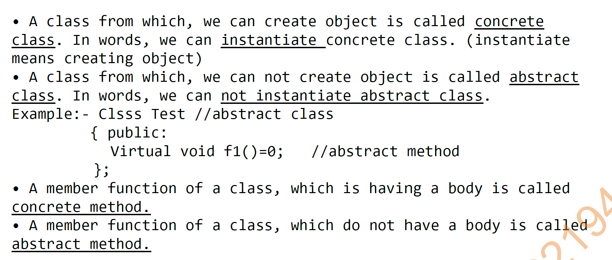
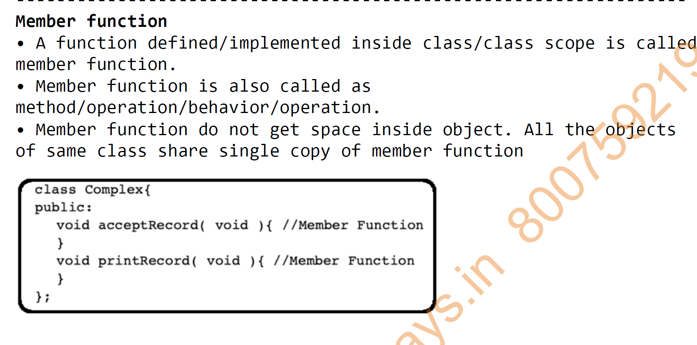
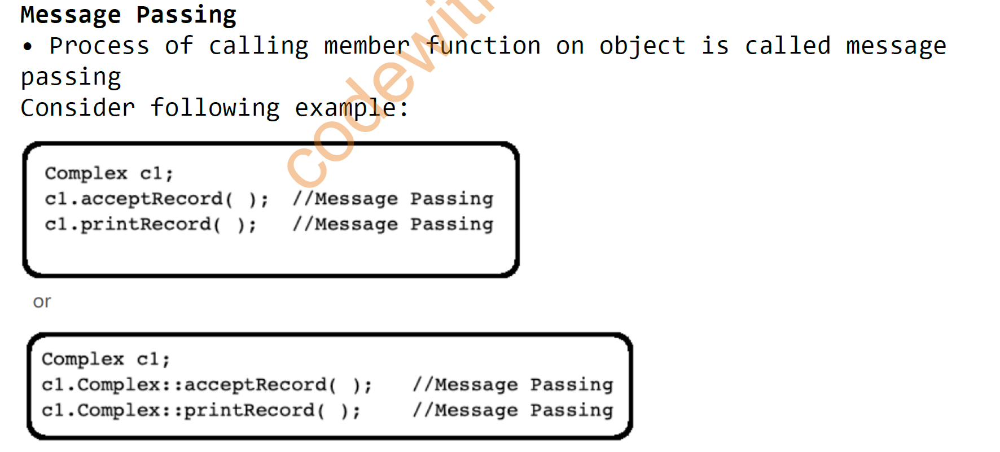

# OOPS NOTES

## August 2026

### 10-08-2026

#### Program1.cpp
````cpp
#include <iostream>
#include <conio.h>
int main()
{
    std::cout << "Hello World" << std::endl;
    std::cout << "Hello World";
    
    return 0;
}
````

#### Program2.cpp
````cpp
#include <iostream>
#include <conio.h>
int main()
{
    using namespace std;
    cout << "Hello World" << endl;
    //endl is manupulator which is used to print new line\n
    cout << "Hello World";
    
    return 0;
}
````

#### Program3.cpp
````cpp
#include <iostream>
#include <conio.h>
int main()
{
    using namespace std;
    
    int num1=10;
    // in cpp lang
    cout << "The value of num1 is: " << num1 << endl;
    //printf("The value of num1 is: %d", num1); in c lang
    
    int num2=20;
    cout << "The value of num2 is: " << num2 << endl;

    cout << num1<< num2 << endl;

    return 0;
}
````

#### Program4.cpp
````cpp
#include <iostream>
#include <conio.h>
int main()
{
    using namespace std;
    
    int num1=10;
    cout << "The value of num1 is: " << num1 << endl;

    int num2=20;
    cout << "The value of num2 is: " << num2 << endl;

    int sum=num1+num2;
    cout << "The sum of num1 and num2 is: " << sum << endl;
    
    return 0;
}
````

#### Program5.cpp
````cpp
#include <iostream>
#include <conio.h>
int main()
{
    using namespace std;
    
    int num1;

    cout << "Enter the value of num1: ";
    cin >> num1;
    
    cout << "The value of num1 is: " << num1 << endl;
    
    return 0;
}
````

#### Program6.cpp
````cpp
#include <iostream>
#include <conio.h>
int main()
{
    using namespace std;
    
    int num1, num2;

    cout << "Enter the value of num1: ";
    //in cpp lang
    
    cin >> num1;
    //scanf("%d",&num); in c lang
    
    cout << "Enter the value of num2: ";
    cin >> num2;
    
    int sum=num1+num2;
    cout << "The sum of num1 and num2 is: " << sum << endl;
    
    return 0;
}
````

#### Program7.cpp
````cpp
/*
Write the cpp program to accept a numer and display its square and cube of the number.
*/

#include <iostream>

int main()
{
    using namespace std;
    
    int num;
    
    cout << "Enter the value of num: ";
    cin >> num;
    
    int square=num*num;
    int cube=num*num*num;
    
    cout << "The square of num is: " << square << endl;
    cout << "The cube of num is: " << cube << endl;
    
    return 0;
}
````

#### Program8.cpp
````cpp
/*
Write a cpp program to accept a number and display product.
*/

#include <iostream>

int main()
{
    using namespace std;
    
    int num1, num2;
    
    cout << "Enter the value of num1: ";
    cin >> num1;
    
    cout << "Enter the value of num2: ";
    cin >> num2;
    
    int product = num1 * num2;
    cout << "The product of num1 and num2 is: " << product << endl;
    
    return 0;
}
````

#### Program9.cpp
````cpp
/*
write a program to calculate the simple interest , taking principle amount , rate of interest and 
number of years as input from user.
*/
#include <iostream>
using namespace std;

int main()
{
    float principal, rate, time, simple_interest;

    cout << "Enter the principal amount: ";
    cin >> principal;

    cout << "Enter the rate of interest: ";
    cin >> rate;

    cout << "Enter the number of years: ";
    cin >> time;

    simple_interest = (principal * rate * time) / 100;

    cout << "The simple interest is: " << simple_interest << endl;

    return 0;
}
````

#### Program10.cpp
````cpp
/*
write a program to accept basic salary.calculate gross salary that include 
DA=50% of basic salary,HRA=40%.
*/

#include <iostream>
using namespace std;

int main()
{
    float basic_salary, da, hra, gross_salary;

    cout << "Enter the basic salary: ";
    cin >> basic_salary;

    da = 0.5 * basic_salary;
    hra = 0.4 * basic_salary;

    gross_salary = basic_salary + da + hra;

    cout << "The gross salary is: " << gross_salary << endl;

    return 0;
}
/*
what is da DA stands for Dearness Allowance. It is a component of an 
employee's salary that is provided to offset 
the impact of inflation on the cost of living. 
In this program, DA is calculated as 50% of the basic salary.

Hra HRA stands for House Rent Allowance. It is a component of 
an employee's salary that is provided to help cover the cost of renting a home.
In this program, HRA is calculated as 40% of the basic salary.
*/ 
````

### 11-08-2026

#### Program1.cpp
````cpp
/*
Write a program to swap two numbers using third variable.
*/
#include <iostream>
using namespace std;

int main()
{
    int a, b, temp;

    cout << "Enter two numbers: ";
    cin >> a >> b;

    temp = a;
    a = b;
    b = temp;

    cout << "After swapping: " << a << " " << b << endl;


    return 0;
}
````

#### Program2.cpp
````cpp
/*
Type casting: 

-converting one data type into another data type is called type casting.
-implicit conversion do not require any special syntax. 
    It is done automatically by the compiler.

- but explicit conversion requires a special syntax. 
    It is done manually by the programmer.

*/
/*
Write a program to accept integer value from user and  
float data type multiply the two numbers.
*/
#include <iostream>
using namespace std;

int main()
{
    int a;
    float b;

    cout << "Enter an integer value: ";
    cin >> a;
    cout << "Enter a float value: ";
    cin >> b;
    float result = a * b;

    cout << "Result: " << result << endl;

    return 0;
}
````

#### Program3.cpp
````cpp
/*
Write a program to accept float number and 
display the interger part of the number using type casting.
*/
#include <iostream>
using namespace std;

int main()
{
    float num;
    int integerPart;

    cout << "Enter a float number: ";
    cin >> num;

    integerPart = (int)num;

    cout << "Integer part: " << integerPart << endl;

    return 0;
}
````

#### Program4.cpp
````cpp
/*what is class in cpp?
In C++, a class is a user-defined data type that serves as a blueprint for creating objects. 
It encapsulates data members (variables) and member functions (methods) that operate on the data. 
Classes allow for the implementation of object-oriented programming concepts such as 
encapsulation, inheritance, and polymorphism.


*/
/*
what is object in cpp?

In C++, an object is an instance of a class. It represents a specific entity that has 
its own state (data members) and behavior (member functions) defined by the class. 

Objects are created based on the blueprint provided by the class, and they can interact with 
each other through their member functions. 

Each object can have different values for its data members, allowing for unique instances 
of the same class.

*/
````

#### Program5.cpp
````cpp
/*Write down the syntax for declaration of class */

class ClassName {
    // Access specifier
    public:
        // Constructor
        ClassName();
        // Destructor
        ~ClassName();
        // Member functions
        void memberFunction();
    private:
        // Data members
        int dataMember;
};
````

#### Program6.cpp
````cpp
/* Declaration of a simple class with name book and creating and object for class*/

#include <iostream>
using namespace std;

class book{
    int book_id;
    char book_name[20];
    int book_price;
};

int main(){
    book b1;
    book b2;
    return 0;
}
````

#### Program7.cpp
````cpp
/*Access Specifiers in C++ 

in c++ 3 access specifiers are used to define the accessibility of class members 
(data members and member functions). 
There are three types of access specifiers in C++:

1. Public: Members declared as public are accessible from anywhere in the program. 
They can be accessed by objects of the class and also by functions outside the class.

2. Private: Members declared as private are accessible only within the class. 
They cannot be accessed by objects of the class or by functions outside the class.

3. Protected: Members declared as protected are accessible within the class and by derived classes. 
They cannot be accessed by objects of the class or by functions outside the class.

*/
````

#### Diagrams




### 12-08-2026

#### Homework.md
````text
# Todays Homework   Date 12/08/2026

# Q1. Write a program to define a class book having data members 
#     bookid , bookname, bookprice , autherName, bookQuantity
#     and member functions to accept and display the details of book.

# Q2. Write a C++ program for Addition of Two Numbers 
#     Using Class and Object having data members num1, num2 
#     and member functions to accept(), add() and display() 
#     the result of addition.
````

#### Program1.cpp
````cpp
/*Definining function of class :

There are three methods of defining member functions of a class in C++:

1. Internally defined member function: The member function is defined inside the class definition.

2. Externally defined member function: The member function is defined outside the 
class definition using the scope resolution operator (::).

3. Inline member function: The member function is defined inside the class definition

*/
````

#### Program2.cpp
````cpp
/* 4M  Write a program to find area of a circle using object oriented programming 
such that the class circle must have three member functions internally namely

a) read() to accept radius of circle from user
b) compute() to calculate area of circle
c) display() to display the area of circle
*/

#include <iostream>
using namespace std;
class Circle {

    float radius, area;

    public: 
    void read() {
        cout << "Enter the radius of the circle: ";
        cin >> radius;
    }   

    void compute() {
        area = 3.14 * radius * radius;
    }

    void display() {
        cout << "The area of the circle is: " << area << endl;
    }

};

int main() {
    Circle c;
    c.read();
    c.compute();
    c.display();
    return 0;
}

/*
ERROR:
If we declare the member function as private
In function 'int main()':
Program19.cpp:33:12: error: 'void Circle::read()' is private within this context
   33 |     c.read();
*/
````

#### Program3.cpp
````cpp
/*Write a program to define a class student having data members 
rollno, name, marks and member functions to accept and display 
the details of student.*/

#include <iostream>
#include <string>
using namespace std;

class Student {
    int rollno;
    //char name[20];
    string name;
    float marks;

public:
    void accept() {
        cout << "Enter name: ";
        cin>>name;
        cout << "Enter roll number: ";
        cin >> rollno;
        cout << "Enter marks: ";
        cin >> marks;
    }

    void display() {
        cout << "Name: " << name << endl;
        cout << "Roll Number: " << rollno << endl;
        cout << "Marks: " << marks << endl;
    }
};

int main() {
    Student s;
    s.accept();
    s.display();
    return 0;
}
````

#### Program4.cpp
````cpp
/*Write a program to define a class employee having data members 
 empid , name, salary and member functions to accept and display 
the details of employee.*/

#include <iostream>
using namespace std;
class Employee {
    private:
    int empid;
    char name[20];
    float salary;

    public:
    void accept() {
        cout << "Enter employee name: ";
        cin >> name;
        cout << "Enter employee ID: ";
        cin >> empid;
        cout << "Enter employee salary: ";
        cin >> salary;
    }
    void display() {
        cout << "Employee Name: " << name << endl;
        cout << "Employee ID: " << empid << endl;
        cout << "Employee Salary: " << salary << endl;
    }
};
int main() {
    Employee e;
    e.accept();
    e.display();
    return 0;
}
````

#### Program5.cpp
````cpp
/*Write a program to define a class book having data members 
 bookid , bookname, bookprice , autherName, bookQuantity
and member functions to accept and display the details of book.*/

#include<iostream>
using namespace std;

class book{
    private:
        int bookid;
        string bookname;
        float bookprice;
        string autherName;
        int bookQuantity;
    public:
        void acceptDetails(){
            cout<<"Enter Book ID: ";
            cin>>bookid;
            cout<<"Enter Book Name: ";
            cin.ignore();
            getline(cin, bookname);
            cout<<"Enter Book Price: ";
            cin>>bookprice;
            cout<<"Enter Author Name: ";
            cin.ignore();
            getline(cin, autherName);
            cout<<"Enter Book Quantity: ";
            cin>>bookQuantity;
        }
        
        void displayDetails(){
            cout<<"\nBook ID: "<<bookid;
            cout<<"\nBook Name: "<<bookname;
            cout<<"\nBook Price: "<<bookprice;
            cout<<"\nAuthor Name: "<<autherName;
            cout<<"\nBook Quantity: "<<bookQuantity<<endl;
        }
};

int main(){

    book b;
    b.acceptDetails();
    b.displayDetails();
    return 0;
}
````

#### Program6.cpp
````cpp
/*Homework 6:
 Write a C++ program for Addition of Two Numbers 
 Using Class and Object having data members num1, num2 
 and member functions to accept(), add() and display() 
 the result of addition.
 */

 #include<iostream>
 using namespace std;

 class Addition{
     private:
         int num1, num2, sum;
     public:
         void accept(){
             cout<<"Enter first number: ";
             cin>>num1;
             cout<<"Enter second number: ";
             cin>>num2;
         }
         
         void add(){
             sum = num1 + num2;
         }
         
         void display(){
             cout<<"The sum of "<<num1<<" and "<<num2<<" is: "<<sum<<endl;
         }
 };
 
 int main(){
     Addition a;
     a.accept();
     a.add();
     a.display();
     return 0;
 }
````

#### Diagrams




### 19-08-2026

#### Homework.md
````text
# Today's Homework Problem on Selection sort   19/08/2026

# Q1. Sort the given data of array using selection sort.              Summer-2026 Q6-A  6Marks
  70, 10, 20, 5, 30  Show each iteration properly.

# Q2 Sort the following number using selection sort.                 Winter-2024  Q6-A 6marks
{35, 14, 5, 102, 61, 10} write the output after each iteration

# Q3 Describe the working of selection sort method with an example   Winter-2025 Q2-B 4marks

# Q4 sort given input list in ascending order using selection sort.  Summer-2025 Q6-A 6marks
{ 16, 22, 12, 56, 65, 78 }

# Today's Homework Problem on CPP               19/08/2026
# Q1 Write a program to define class ‘staff’ with datamembers, name, designation
#    & experience in years. Accept data for five objects from the user. 
#   Display the name of staff who are manager                        Winter-2024 Q5-A  6 Marks
                                                               

# Q2 Write a C++ program to define a class Vehicle with data members modelName, 
#  company and mileage. Accept data for five objects from the user. 
#  Display the modelName, company of the vehicle having the mileage above 80.

# Q3 Write a C++ program to define a class Movie with data members title, language and rating. 
#    Accept data for five objects from the user. Display the titles of movies having 
#    a rating greater than 8

# Q4 Write a C++ program to define a class BankAccount with data members accountNo, 
#    holderName and balance. Accept data for five objects from the user. Display the account 
#    holder's name and accountNo whos balance is less than 3000.
````

#### Program1.cpp
````cpp
/*
Write a C++ program to find area of rectangle using class rectangle which has
following details :
 (i) Accept length and breadth from user
 (ii) Calculate area
 (iii) Display result 

 Summer-2026 Q3 - C
*/

#include<iostream>
using namespace std;

class Rectangle{
    private:
        float length, breadth, area;
    public:
        void accept(){
            cout<<"Enter length: ";
            cin>>length;
            cout<<"Enter breadth: ";
            cin>>breadth;
        }
        
        void calculateArea(){
            area = length * breadth;
        }
        
        void display(){
            cout<<"The area of the rectangle is: "<<area<<endl;
        }
};

int main(){
    Rectangle r;
    r.accept();
    r.calculateArea();
    r.display();
    return 0;
}
````

#### Program2.cpp
````cpp
/*
Write a program to declare a class ‘employee’ having data members 
‘emp-id’ and ‘salary’. Accept and display this data for 10 employees

Summer-2026 Q5 - A 6 Mark
*/

#include<iostream>
using namespace std;

class Employee{
    private:
        int empId;
        float salary;
    public:
        void acceptData(){
            cout<<"Enter Employee ID: ";
            cin>>empId;
            cout<<"Enter Salary: ";
            cin>>salary;
        }
        
        void displayData(){
            cout<<"\nEmployee ID: "<<empId;
            cout<<"\nSalary: "<<salary<<endl;
        }
};

int main(){
    Employee e[10];
    for(int i = 0; i < 10; i++){
        e[i].acceptData();
    }
    for(int i = 0; i < 10; i++){
        e[i].displayData();
    }
    return 0;
}
````

#### Program3.cpp
````cpp
/*
Write C++ program to declare a class mobile having data members price and
model number. Accept & display data for 10 objects. 

Summer-2025 Q2- B 4 Mark
*/
#include<iostream>
using namespace std;
class Mobile{
    private:
        float price;
        int modelNumber;
    public:
        void acceptData(){
            cout<<"Enter Model Number: ";
            cin>>modelNumber;
            cout<<"Enter Price: ";
            cin>>price;
        }
        
        void displayData(){
            cout<<"\nModel Number: "<<modelNumber;
            cout<<"\nPrice: "<<price<<endl;
        }
};
int main(){
    Mobile m[10];
    for (int i = 0; i <10; i++)
    {
        m[i].acceptData();
    }
    for (int i = 0; i <10; i++){
        m[i].displayData();
    }
}
````

#### Program4.cpp
````cpp
/*
Write a program to declare a class ‘staff’ having data member as name and
department. Accept this data for 10 staff and display names of staff that are
CM department.

Summer-2025 Q6- C  6 Mark
*/
#include<iostream>
using namespace std;

class Staff{
    private:
        string name;
        string department;
    public:
        void acceptData(){
            cout<<"Enter Staff Name: ";
            cin.ignore();
            getline(cin, name);
            cout<<"Enter Department: ";
            getline(cin, department);
        }
        
        void displayData(){
            if(department == "CM"){
                cout<<"\nStaff Name: "<<name;
                cout<<"\nDepartment: "<<department<<endl;
            }
        }
};
int main(){
    Staff s[10];
    for (int i = 0; i <10; i++)
    {
        s[i].acceptData();
    }
    for (int i = 0; i <10; i++){
        s[i].displayData();
    }
    return 0;
}
````

#### Program5.cpp
````cpp
/*
Write a program to define class ‘staff’ with datamembers, name, designation
& experience in years. Accept data for five objects from the user. Display the
name of staff who are manager

Winter-2024 Q5-A  6 Marks
*/
#include<iostream>
using namespace std;

class Staff{
    private:
    string name;
    string designation;
    int experience;
    
    public:
    void accept(){
        cout<<"Enter a staff name";
        cin>>name;
        cout<<"Enter a staff designation";
        cin>>designation;
        cout<<"Enter a staff experience in year";
        cin>>experience;
    }

    void display(){
        if (designation=="Manager")
        {
            cout<<"Staff Name is : "<<name<<endl;
            cout<<"Staff Designation is : "<<designation<<endl;
            cout<<"Staff experience is : "<<experience<<endl;

        }
        
    }
};

int main(){
    
    Staff s[5];
    for (int i = 0; i < 5; i++)
    {
        s[i].accept();
    }
    for (int i = 0; i < 5; i++)
    {
        s[i].display();
    }
    
    return 0;

}
````

### 20-08-2026

#### Program1.cpp
````cpp
/* 
Externally defined member function of class in C++ using:

Scope resolution Operator
->Now in this program member function definition written outside
the class function and declaration of member function given in the
class.
-> that’s why we used here :: scope resolution operator for member
function and it is denotes as(::)

*/
#include <iostream>
using namespace std;
class Employee {
    private:
    int empid;
    char name[20];
    float salary;

    public:
    void accept();
    void display();
};

void Employee::accept() {
    cout << "Enter employee name: ";
    cin >> name;
    cout << "Enter employee ID: ";
    cin >> empid;
    cout << "Enter employee salary: ";
    cin >> salary;
}

void Employee::display() {
    cout << "Employee Name: " << name << endl;
    cout << "Employee ID: " << empid << endl;
    cout << "Employee Salary: " << salary << endl;
}

int main() {
    Employee e;
    e.accept();
    e.display();
    return 0;
}
````

#### Program2.cpp
````cpp
/*Multiple objects program*/

#include <iostream>
using namespace std;

class Employee {
    private:
    int empid;
    char name[20];
    float salary;

    public:
    void accept();
    void display();

};

    void Employee::accept() {
        cout << "Enter employee name: ";
        cin >> name;
        cout << "Enter employee ID: ";
        cin >> empid;
        cout << "Enter employee salary: ";
        cin >> salary;
    }
    void Employee::display() {
        cout << "Employee Name: " << name << endl;
        cout << "Employee ID: " << empid << endl;
        cout << "Employee Salary: " << salary << endl;
    }
    int main(){
        
        Employee e1, e2,e3;
        cout << "Enter details for employee 1:" << endl;
        e1.accept();
        cout << "Enter details for employee 2:" << endl;
        e2.accept();
        cout << "Enter details for employee 3:" << endl;
        e3.accept();

        cout << "\nDetails of employee 1:" << endl;
        e1.display();
        cout << "\nDetails of employee 2:" << endl;
        e2.display();
        cout << "\nDetails of employee 3:" << endl;
        e3.display();

        return 0;
    }
````

#### Program3.cpp
````cpp

/*Write a program to find area of a circle using object oriented programming 
such that the class circle must have three member functions externally namely
 
a) read() to accept radius of circle from user
b) compute() to calculate area of circle
c) display() to display the area of circle
*/

#include <iostream>
using namespace std;

class Circle {

    float radius, area;

    public: 
    void read();
    void compute();
    void display();
};

void Circle::read() {
    cout << "Enter the radius of the circle: ";
    cin >> radius;
}

void Circle::compute() {
    area = 3.14 * radius * radius;
}

void Circle::display() {
    cout << "The area of the circle is: " << area << endl;
}

int main() {
    Circle c;
    c.read();
    c.compute();
    c.display();
    return 0;
}
````

#### Program4.cpp
````cpp
/*
Nesting member function:
*/

#include <iostream>
using namespace std;    

class Circle {
    float radius, area;

    public: 
    void read();
    void compute();
    void display();
};  

void Circle::read() {
    cout << "Enter the radius of the circle: ";
    cin >> radius;
}

void Circle::compute() {
    area = 3.14 * radius * radius;
}

void Circle::display() {
    compute(); // Calling compute() function from display()
    cout << "The area of the circle is: " << area << endl;
}

int main() {
    Circle c;
    c.read();
    c.display(); // This will call compute() internally
    return 0;
}
````

#### Program5.cpp
````cpp
/*
Inline functions: 
    -We have seen that functions are defined inside or outside the class.
    
    -If a function is definde outside the class, but still be treated as 
    internally defined function, then it is called inline function.

    -The inline function is defined outside the class using the keyword inline.
    
    Syntax:
    inline return_type class_name::function_name(parameters)
    {
        // statements
    }
   
    -The advantage of inline function is that the execution is faster 
    even though the function is defined outside the class.
*/
````

#### Program6.cpp
````cpp
/*
Write a program to find area of a circle using object oriented programming
such that the class circle must have three inline member functions namely
a) read() to accept radius of circle from user
b) compute() to calculate area of circle
c) display() to display the area of circle
*/


#include <iostream>
using namespace std;

class circle{

    private:
    float radius, area;

    public:
    void read();
    void compute();
    void display();
};

inline void circle:: read(){
    cout<<"Enter a radius ";
    cin>>radius;
}


inline void circle:: compute(){
                area=3.14*radius*radius;
}

inline void circle::display(){
    cout<<"Area of cicle is :" <<area<<endl;
    cout<<"Area of cicle is :" <<area;
}


int main(){
        circle c;
        c.read();
        c.compute();
        c.display();
}
````

#### Program7.cpp
````cpp
/*
Q2 Write a C++ program to define a class Vehicle with data members modelName, 
company and mileage.define as inline member function to Accept data for five 
objects from the user. 
Display the modelName, company of the vehicle having the mileage above 80.
*/
#include<iostream>
#include<String>
using namespace std;

class Vehicle{

    private:
    string modelName;
    string companyName;
    float mileage;

    public:
    void acceptRecord();
    void displayRecord();
};

inline void Vehicle:: acceptRecord(){

    cout<<"Enter a model name"<<endl;
    cin>>modelName;
    cout<<"Enter a company name"<<endl;
    cin>>companyName;
    cout<<"Enter a mileage of bike"<<endl;
    cin>>mileage;
}

inline void Vehicle::displayRecord(){
    if(mileage>80){
        cout<<"model name is: "<<modelName<<endl;
        cout<<"Company name is: "<<companyName<<endl;
    }
}
int main(){
    Vehicle v[5];
    for (int i = 0; i<5; i++)
    {
        v[i].acceptRecord();
    }
    for (int i = 0; i <5; i++)
    {
        v[i].displayRecord();
    }
    
}
````

### 21-08-2026

#### Program1.cpp
````cpp
/*
1. Problem: Without Constructor

Suppose we create a Student class having rollNo and marks.

Every time we create an object, we have to manually assign values.

*/

#include <iostream>
using namespace std;

class Student
{
public:
    int rollNo;
    float marks;
};

int main()
{
    Student s1;

    s1.rollNo = 101;
    s1.marks = 85.5;

    cout << "Roll No: " << s1.rollNo << endl;
    cout << "Marks: " << s1.marks << endl;

    return 0;
}
````

#### Program2.cpp
````cpp

/*
2. Problem: Without Constructor

Suppose we create a patient class having patientId, name , age and roomNo.

Every time we create an object, we have to manually assign values.

*/
#include <iostream>
using namespace std;

class Patient
{
public:
    int patientId;
    string name;
    int age;
    int roomNo;
};

int main()
{
    Patient p1;

    p1.patientId = 1001;
    p1.name = "Amit";
    p1.age = 35;
    p1.roomNo = 205;

    cout << "Patient ID: " << p1.patientId << endl;
    cout << "Name: " << p1.name << endl;
    cout << "Age: " << p1.age << endl;
    cout << "Room No: " << p1.roomNo << endl;

    return 0;
}
````

#### Program3.cpp
````cpp
/*
3. Problem: Without Constructor

Suppose we create a Laptop class having serialNo, brand,ram,storage,price.

Every time we create an object, we have to manually assign values.

*/
#include <iostream>
using namespace std;

class Laptop
{
public:
    int serialNo;
    string brand;
    int ram;
    int storage;
    float price;
};

int main()
{
    Laptop l1;

    l1.serialNo = 1001;
    l1.brand = "Dell";
    l1.ram = 16;
    l1.storage = 512;
    l1.price = 65000;

    cout << "Serial No: " << l1.serialNo << endl;
    cout << "Brand: " << l1.brand << endl;
    cout << "RAM: " << l1.ram << " GB" << endl;
    cout << "Storage: " << l1.storage << " GB" << endl;
    cout << "Price: " << l1.price << endl;

    return 0;
}
````

#### Program4.cpp
````cpp
/*
4. Problem: Without Constructor

Suppose we create a Laptop class having serialNo, brand,ram,storage,price.

Every time we create an object, we have to manually assign values.

*/
#include <iostream>
using namespace std;

class Laptop
{
public:
    int serialNo;
    string brand;
    int ram;
    int storage;
    float price;

    void acceptRecord()
    {
        cout << "Enter Serial No: ";
        cin >> serialNo;

        cout << "Enter Brand: ";
        cin >> brand;

        cout << "Enter RAM: ";
        cin >> ram;

        cout << "Enter Storage: ";
        cin >> storage;

        cout << "Enter Price: ";
        cin >> price;
    }

    void displayRecord()
    {
        cout << "\n--- Laptop Details ---" << endl;
        cout << "Serial No: " << serialNo << endl;
        cout << "Brand: " << brand << endl;
        cout << "RAM: " << ram << " GB" << endl;
        cout << "Storage: " << storage << " GB" << endl;
        cout << "Price: " << price << endl;
    }
};

int main()
{
    Laptop l1;

    l1.acceptRecord();
    l1.displayRecord();

    return 0;
}
````

#### Program5.cpp
````cpp
/*
2. Solution: Constructor

A constructor is a special member function that is automatically called when an object is created.

It is mainly used to initialize the data members of an object.

Properties of Constructor:
1. The name of constructor is the same as the class name.
2. It has to be defined only in the public visibility of class.
3. it should not have any return type, not even void.
4. The constructor is automatically invoked when the object is created.
5. It can have default arguments.
6. A constructor cannot be inherited, but the derived class can call the base class constructor.
7. A constructor cannot be declared as static or virtual.
*/

#include<iostream>
#include<String>

using namespace std;

class Patient{

    public:
    int pid;
    string name;
    int age;

    //Parameteless constructor;
    Patient(){
        cout<<"Constructor is called"<<endl;
    }

    //Parameterized constructor
    Patient(int p, string n, int a){
        pid=p;
        name=n;
        age=a;
    }
    void display(){
        cout<<"patient id is :"<<pid<<endl;
        cout<<"patient name is :"<<name<<endl;
        cout<<"patient age is :"<<age<<endl;
    }

};

int main(){
    Patient p1(101, "Ashok", 21);
    Patient p2(202, "Sarthak", 20);
    Patient p3(303, "Krushna", 19);
    Patient p4;
    p1.display();
    p2.display();
    p3.display();
}
````

#### Program6.cpp
````cpp
/*
2. Solution: Constructor
*/

#include <iostream>
using namespace std;    

class Student
{
public:
    int rollNo;
    float marks;

    // Constructor
    Student(int r, float m) {
        rollNo = r;
        marks = m;
    }
};

int main()
{
    Student s1(101, 85.5);
    Student s2(102, 78.5);
    Student s3(103, 91.5);

    cout << "Roll No: " << s1.rollNo << endl;
    cout << "Marks: " << s1.marks << endl;

    cout << "Roll No: " << s2.rollNo << endl;
    cout << "Marks: " << s2.marks << endl;

    cout << "Roll No: " << s3.rollNo << endl;
    cout << "Marks: " << s3.marks << endl;

    return 0;
}
````

#### Program7.cpp
````cpp
#include <iostream>
using namespace std;

class Laptop
{
private:
    int serialNo;
    string brand;
    int ram;
    int storage;
    float price;

public:

    // parameterless Constructor
    Laptop()
    {
        cout << "Enter Serial No: ";
        cin >> serialNo;

        cout << "Enter Brand: ";
        cin >> brand;

        cout << "Enter RAM: ";
        cin >> ram;
        cin >> ram;

        cout << "Enter Storage: ";
        cin >> storage;

        cout << "Enter Price: ";
        cin >> price;
    }

    void displayRecord()
    {
        cout << "\n--- Laptop Details ---" << endl;
        cout << "Serial No: " << serialNo << endl;
        cout << "Brand: " << brand << endl;
        cout << "RAM: " << ram << " GB" << endl;
        cout << "Storage: " << storage << " GB" << endl;
        cout << "Price: " << price << endl;
    }
};

int main()
{
    Laptop l1;    // Constructor automatically called

    l1.displayRecord();

    return 0;
}
````

#### Program8.cpp
````cpp
#include <iostream>
using namespace std;

class Laptop
{
private:
    int serialNo;
    string brand;
    int ram;
    int storage;
    float price;

public:

    // Parameterized Constructor
    Laptop(int s, string b, int r, int st, float p)
    {
        serialNo = s;
        brand = b;
        ram = r;
        storage = st;
        price = p;
    }

    void displayRecord()
    {
        cout << "\n--- Laptop Details ---" << endl;
        cout << "Serial No: " << serialNo << endl;
        cout << "Brand: " << brand << endl;
        cout << "RAM: " << ram << " GB" << endl;
        cout << "Storage: " << storage << " GB" << endl;
        cout << "Price: " << price << endl;
    }
};

int main()
{
    int serialNo, ram, storage;
    string brand;
    float price;

    cout << "Enter Serial No: ";
    cin >> serialNo;

    cout << "Enter Brand: ";
    cin >> brand;

    cout << "Enter RAM: ";
    cin >> ram;

    cout << "Enter Storage: ";
    cin >> storage;

    cout << "Enter Price: ";
    cin >> price;

    // Passing user values to constructor
    Laptop l1(serialNo, brand, ram, storage, price);

    l1.displayRecord();

    return 0;
}
````

#### Program9.cpp
````cpp
#include <iostream>
using namespace std;

class Laptop
{
private:
    int serialNo;
    string brand;
    int ram;
    int storage;
    float price;

public:

    // Parameterized Constructor
    /*When we want the same name to construtor datamember as already define
    data member then we use the this->  keyword*/
    Laptop(int serialNo, string brand, int ram, int storage, float price)
    {
        this->serialNo = serialNo;
        this->brand = brand;
        this->ram = ram;
        this->storage = storage;
        this->price = price;
    }

    void displayRecord()
    {
        cout << "\n--- Laptop Details ---" << endl;
        cout << "Serial No: " << serialNo << endl;
        cout << "Brand: " << brand << endl;
        cout << "RAM: " << ram << " GB" << endl;
        cout << "Storage: " << storage << " GB" << endl;
        cout << "Price: " << price << endl;
    }
};

int main()
{
    int serialNo, ram, storage;
    string brand;
    float price;

    cout << "Enter Serial No: ";
    cin >> serialNo;

    cout << "Enter Brand: ";
    cin >> brand;

    cout << "Enter RAM: ";
    cin >> ram;

    cout << "Enter Storage: ";
    cin >> storage;

    cout << "Enter Price: ";
    cin >> price;

    // Passing user values to constructor
    Laptop l1(serialNo, brand, ram, storage, price);

    l1.displayRecord();

    return 0;
}
````

#### Program10.cpp
````cpp
/*
Type of constructor: 
1.Default constructor / parameterless constructor
    -If a class does not have any constructor, then the compiler automatically 
    provides a default constructor.
    -If a constructor does not have any parameter, then it is called default constructor or parameterless constructor
    
2.Parameterized constructor
    -If a constructor has one or more parameters, then it is called parameterized constructor.
    Thus, the parameterized constructor has argument list written in the brackets
    associated with the constructor name.
    

3.Copy constructor

Write a program to find area of a circle using object oriented programming
The value of radius is to be accepted from user in the constructor of the class circle. 
and class circle must have two member functions namely
a) compute() to calculate area of circle
b) display() to display the area of circle
*/

#include <iostream>
using namespace std;

class circle {
    float radius, area;


public:
    circle(){
        cout<<"Enter the radius of the circle: ";
        cin>>radius;
    }
    void compute();
    void display();
};

inline void circle::compute() {
    area = 3.14 * radius * radius;
}

inline void circle::display() {
    cout<<"The area of the circle is: "<<area<<endl;
}

int main() {
    circle c;
    c.compute();
    c.display();
    return 0;
}
````

#### Program11.cpp
````cpp
/* Write a cpp program define class laptop having data members serialno, brand
ram , storage , price accept data/ innitilize the data from constructor and display
 the record. */

#include <iostream>
using namespace std;

class Laptop
{
private:
    int serialNo;
    string brand;
    int ram;
    int storage;
    float price;

public:

    Laptop(int serialNo, string brand, int ram, int storage, float price)
    {
        this->serialNo=serialNo;
        this->brand=brand;
        this->ram=ram;
        this->storage=storage;
        this->price=price;
    }

    void displayRecord()
    {
        cout << "Serial No: " << serialNo << endl;
        cout << "Brand: " << brand << endl;
        cout << "RAM: " << ram << " GB" << endl;
        cout << "Storage: " << storage << " GB" << endl;
        cout << "Price: " << price << endl;
    }
};

int main()
{
    Laptop l1(1001, "Dell", 16, 512, 65000);

    l1.displayRecord();

    return 0;
}
````

### 22-08-2026

#### Program1.cpp
````cpp
/*
Parameterized Constructor: 

Write a C++ program to create a class Rectangle with data members length and breadth. 
Use a parameterized constructor to initialize the values and calculate the area.
*/


#include <iostream>
using namespace std;

class Rectangle {
private:
    double length;
    double breadth;

public:
    Rectangle(double l, double b) {
        length = l;
        breadth = b;
    }

    double calculateArea() {
        return length * breadth;
    }
};

int main() {
    Rectangle r(5.0, 3.0);
    cout << "Area of the rectangle: " << r.calculateArea() << endl;
    return 0;
}
````

#### Program2.cpp
````cpp
/*
Write a C++ program to create a class BankAccount with account number and balance. 
Use a parameterized constructor to initialize the account number and balance. 
Display the details.
*/
#include <iostream>
using namespace std;

class BankAccount {
private:
    int accountNumber;
    double balance;

public:
    BankAccount(int accNum, double bal) {
        accountNumber = accNum;
        balance = bal;
    }

    void displayDetails() {
        cout << "Account Number: " << accountNumber << endl;
        cout << "Balance: " << balance << endl;
    }
};

int main() {
    BankAccount ba(12345, 1000.0);
    ba.displayDetails();
    return 0;
}
````

#### Program3.cpp
````cpp
/*
Write a C++ program to create a class Product with data members productId, price and quantity. 
Use a parameterized constructor to initialize all values and calculate the total amount.
*/
#include <iostream>
using namespace std;

class Product {
private:
    int productId;
    double price;
    int quantity;

public:
    Product(int id, double p, int q) {
        productId = id;
        price = p;
        quantity = q;
    }

    double calculateTotalAmount() {
        return price * quantity;
    }
};

int main() {
    Product p(1, 10.0, 5);
    cout << "Total amount: " << p.calculateTotalAmount() << endl;
    return 0;
}
````

#### Program4.cpp
````cpp
/*
Write a C++ program, to declare a class distance having data members km,
meter, cm, mm. Accept and display data for one object using constructor
concept.
Summer-2025 Q3- B)   4Marks
*/
#include <iostream>
using namespace std;

class Distance{
    private:
    int km;
    int meter;
    int cm;
    int mm;

    public:

    //parameteerless
    Distance(){
        cout<<"Parameterless construtor called";
    }

    //Parameterized constructor
    Distance(int km,  int meter, int cm , int mm){
        this->km=km;
        this->meter=meter;
        this->cm=cm;
        this->mm=mm;
    }

    void display(){
        cout<<"Kilometer is: "<<km<<endl;
        cout<<"meter is: "<<meter<<endl;
        cout<<"centimeter is: "<<cm<<endl;
        cout<<"milimeter is: "<<mm<<endl;
    }
};

int main(){

    int km , meter, cm, mm;

cout<<"Enter a kilometer value: "<<endl;
    cin>>km;
cout<<"Enter a meter value: "<<endl;
    cin>>meter;
cout<<"Enter a centimeter value: "<<endl;
    cin>>cm;
cout<<"Enter a milimeter value: "<<endl;
    cin>>mm;
    
    Distance d1(km, meter,cm,mm);
    d1.display();
}
````

### 31-08-2026

#### Program1.cpp
````cpp
/*
Homework Questions for Students

Default Constructor

Create a Car class and initialize model and price using a default constructor.
Create a Book class and initialize book ID and price using a default constructor.
Create a Mobile class and initialize brand and price using a default constructor.

Parameterized Constructor

Create a Student class and initialize roll number, name and marks using a parameterized constructor.
Create a Circle class and initialize radius using a parameterized constructor and calculate area.
Create an Employee class and initialize employee ID, name and salary using a parameterized constructor.
Create a Box class and initialize length, breadth and height using a parameterized constructor and calculate volume.
*/
````

#### Program2.cpp
````cpp
/*
Destructor in C++ — Basics First

A destructor is a special member function of a class that is automatically 
called when an object is destroyed.

    -When the object is created, the constructor is called.
    -When the object is no longer needed, the destructor is automatically called
*/
/*
Syntax of Destructor

A destructor:

Has the same name as the class
Starts with ~ (tilde)
Has no return type
Takes no arguments
Is called automatically
A class can have only one destructor

class Demo
{
public:

    Demo()       // Constructor
    {
    }

    ~Demo()      // Destructor
    {
    }
};

*/
````

#### Program3.cpp
````cpp
/*
Basic Destructor
Problem

Write a C++ program to demonstrate the use of a destructor.
*/
#include <iostream>
using namespace std;

class Demo
{
public:
    Demo()
    {
        cout << "Constructor is called" << endl;
    }

    ~Demo()
    {
        cout << "Destructor is called" << endl;
    }
};

int main()
{
    Demo d1;

    cout << "Object is being used" << endl;

    return 0;
}

/*
Execution
Demo d1;
   ↓
Constructor is called
   ↓
Object is used
   ↓
main() ends
   ↓
Destructor is called
*/
````

#### Program4.cpp
````cpp
/*
Example 2: Constructor + Destructor with Data
Problem

Write a C++ program to accept and display student details using constructor and destructor.
*/
#include <iostream>
using namespace std;

class Student
{
    int rollNo;
    string name;

public:

    // Constructor
    Student(int r, string n)
    {
        rollNo = r;
        name = n;

        cout << "Constructor is called" << endl;
    }

    void display()
    {
        cout << "Roll No: " << rollNo << endl;
        cout << "Name: " << name << endl;
    }

    // Destructor
    ~Student()
    {
        cout << "Destructor is called" << endl;
    }
};

int main()
{
    Student s1(101, "Rahul");

    s1.display();

    return 0;
}

/*
Constructor is called
Roll No: 101
Name: Rahul
Destructor is called
*/
````

#### Program5.cpp
````cpp
/*
Example 3: Destructor with Two Objects

This is important for understanding when the destructor is called.

Problem

Write a C++ program to demonstrate destructor execution for two objects.
*/

#include <iostream>
using namespace std;

class Demo
{
    int x;

public:

    Demo(int a)
    {
        x = a;
        cout << "Constructor: " << x << endl;
    }

    ~Demo()
    {
        cout << "Destructor: " << x << endl;
    }
};

int main()
{
    Demo d1(10);
    Demo d2(20);

    cout << "Objects are being used" << endl;

    return 0;
}
/*
Constructor: 10
Constructor: 20
Objects are being used
Destructor: 20
Destructor: 10
*/
````

#### Program6.cpp
````cpp
/*
Example 5: Practical Problem — Bank Account
Problem

Write a C++ program to create a BankAccount class with constructor and destructor.
*/
#include <iostream>
using namespace std;

class BankAccount
{
    int accountNo;
    float balance;

public:

    // Constructor
    BankAccount(int acc, float bal)
    {
        accountNo = acc;
        balance = bal;

        cout << "Account created" << endl;
    }

    void display()
    {
        cout << "Account No: " << accountNo << endl;
        cout << "Balance: " << balance << endl;
    }

    // Destructor
    ~BankAccount()
    {
        cout << "Account object destroyed" << endl;
    }
};

int main()
{
    BankAccount b1(1001, 25000);

    b1.display();

    return 0;
}
/*
Account created
Account No: 1001
Balance: 25000
Account object destroyed
*/
````

#### Program7.cpp
````cpp
/*

Constructor                     vs          Destructor

1. Same name as class	                    1. Same name as class with ~
2. Called when object is created	        2. Called when object is destroyed
3. Used for initialization	                3. Used for cleanup
4. Can have parameters	                    4. Cannot have parameters
5. Can be overloaded	                    5. Cannot be overloaded
6. Example: Demo()	                        6. Example: ~Demo()
*/
````

#### Program8.cpp
````cpp
/*
A friend function is a function that is not a member of a class, but it is allowed to access 
the private and protected members of that class.

Syntax of Friend Function:
class ClassName
{
private:
    int x;

public:
    friend void functionName(ClassName obj);
};
--------------------------------------------------------
The function is generally defined outside the class:

void functionName(ClassName obj)
{
    // Can access private members
}

-A friend function is not a member function of the class.
-It is declared inside the class using the keyword friend.
-It can access private members of the class.
-It can also access protected members of the class.
-It is defined outside the class like a normal function.
-It is called like a normal function, not using an object with dot operator.
    display(s1);
Not
    s1.display();

-A friend function does not have a this pointer because it is not a member function.
-A friend function can be declared in the public or private section of a class. Its access is
 not affected by where the declaration appears.
-One friend function can be declared as a friend of more than one class.
-Friend functions are useful when an operation needs access to private data of multiple classes.
*/
````

## September 2026

### 02-09-2026

#### Homework.md
````text

# Todays Homework Question on Friend Function      Date: 02/09/2026

# QUESTION 1:
Create a class Number with private data member num. 
Create two objects and use a friend function to add their values.

# QUESTION 2:
Write a C++ program with two classes Theory and Practical. 
Store marks in private data members. Use a friend function to calculate total marks.

# QUESTION 3:
Write a C++ program with two classes Employee1 and Employee2. Store their salaries as private data members.
Use a friend function to compare their salaries.

# QUESTION 4: 
Write a C++ program with two classes BankSBI and BankHDFC, BankIDBI Store the account balance
in each class as private data. Use a friend function to calculate the total balance.
````

#### Program1.cpp
````cpp
/*
A friend function is a function that is not a member of a class, but it is allowed to access 
the private and protected members of that class.

Syntax of Friend Function:
class ClassName
{
private:
    int x;

public:
    friend void functionName(ClassName obj);
};
--------------------------------------------------------
The function is generally defined outside the class:

void functionName(ClassName obj)
{
    // Can access private members
}

-A friend function is not a member function of the class.
-It is declared inside the class using the keyword friend.
-It can access private members of the class.
-It can also access protected members of the class.
-It is defined outside the class like a normal function.
-It is called like a normal function, not using an object with dot operator.
    display(s1);
Not
    s1.display();

-A friend function does not have a this pointer because it is not a member function.
-A friend function can be declared in the public or private section of a class. Its access is
 not affected by where the declaration appears.
-One friend function can be declared as a friend of more than one class.
-Friend functions are useful when an operation needs access to private data of multiple classes.
*/
````

#### Program2.cpp
````cpp
/*
Problem

Write a C++ program to create a class Student having private data member marks.
Create a normal function display() to display marks.
*/


#include <iostream>
using namespace std;

class Student
{
private:
    int marks;

public:
    Student()
    {
        marks = 85;
    }
    void display(Student s);
};

void display(Student s)
{
    //We cannot acces private data memeber so the solution 
    // is friend function and in next program we apply the 
    //friend function.
    cout << "Marks: " << s.marks;
}

int main()
{
    Student s1;

    display(s1);

    return 0;
}
/*
❌ Problem

This gives an error because:

s.marks

is private.

A normal external function cannot access private data.
*/
````

#### Program3.cpp
````cpp
/*
Solution using friend function
*/

#include <iostream>
using namespace std;

class Student
{
private:
    int marks;

public:
    Student()
    {
        marks = 85;
    }
   friend void display(Student s);
};

//now we can access the private data member because of friend function
void display(Student s)
{
    cout << "Marks: " << s.marks;
}

int main()
{
    Student s1;

    display(s1);

    return 0;
}
````

#### Program4.cpp
````cpp
/*
Problem 2: Calculate Employee Salary
Question

Create a class Employee with private data members basicSalary and bonus.
Write a friend function to calculate and display the total salary.
*/
#include <iostream>
using namespace std;

class Employee
{
private:
    float basicSalary;
    float bonus;

public:

    Employee(float b, float bo)
    {
        basicSalary = b;
        bonus = bo;
    }

    friend void calculateSalary(Employee e);
};

void calculateSalary(Employee e)
{
    float total;

    total = e.basicSalary + e.bonus;

    cout << "Basic Salary: " << e.basicSalary << endl;
    cout << "Bonus: " << e.bonus << endl;
    cout << "Total Salary: " << total << endl;
}

int main()
{
    Employee e1(30000, 5000);

    calculateSalary(e1);

    return 0;
}
````

#### Program5.cpp
````cpp
/*
Problem: 3
Create a class Number with a private data member num.
Create two objects and use a friend function to find and display the greater number.
*/

#include<iostream>
using namespace std;

class Number{

    private:
    int num;
    public:
    Number(int n){
        num=n;
    }

  friend  void greaterNumber(Number n1, Number n2);

};

void greaterNumber(Number n1, Number n2){

    if (n1.num > n2.num)
    {
        cout<<"Number n1 is greater"<<n1.num;
    }
    else if (n2.num> n1.num)
    {
        cout<<"Number N2 is greater"<<n2.num;
    }
    else{
        cout<<"Both number are eequal";
    }
    
}


int main(){
    Number n1(100);
    Number n2(400);

    greaterNumber(n1, n2);

}
````

#### Program6.cpp
````cpp
/*
Problem-4
Create a class Number with private data member num. 
Create two objects and use a friend function to add their values.
*/
// homework
````

#### Program7.cpp
````cpp
/*
Problem 6: Friend Function with Two Different Classes

Question

Create two classes Student and Sports. Store marks in Student and sports marks in Sports. 
Use a friend function to calculate the total marks.

*/

#include <iostream>
using namespace std;

class Sports;

class Student
{
private:
    int academicMarks;

public:

    Student(int m)
    {
        academicMarks = m;
    }

    friend void totalMarks(Student s, Sports sp);
};

class Sports
{
private:
    int sportsMarks;

public:

    Sports(int m)
    {
        sportsMarks = m;
    }

    friend void totalMarks(Student s, Sports sp);
};

void totalMarks(Student s, Sports sp)
{
    cout << "Academic Marks: " << s.academicMarks << endl;
    cout << "Sports Marks: " << sp.sportsMarks << endl;

    cout << "Total Marks: "
         << s.academicMarks + sp.sportsMarks << endl;
}

int main()
{
    Student s1(80);
    Sports sp1(15);

    totalMarks(s1, sp1);

    return 0;
}
````

#### Program8.cpp
````cpp
/*
Problem:5
Write a C++ program with two classes Theory and Practical. 
Store marks in private data members. Use a friend function to calculate total marks.
*/
//Homework
````

#### Program9.cpp
````cpp
/*
problem 7
Write a C++ program with two classes Employee1 and Employee2. Store their salaries as private data members.
Use a friend function to compare their salaries.
*/
// Homework
````

#### Program10.cpp
````cpp
/*
Problem :8 
Write a C++ program with two classes BankSBI and BankHDFC, BankIDBI Store the account balance in each class as private data. 
Use a friend function to calculate the total balance.
*/
//Homework
````

### 03-09-2026

#### Program1.cpp
````cpp
/*
Problem-4
Create a class Number with private data member num. 
Create two objects and use a friend function to add their values.
*/
#include <iostream>
using namespace std;

class Number
{
private:
    int num;

public:

    Number(int n)
    {
        num = n;
    }

    friend void add(Number n1, Number n2);
};

void add(Number n1, Number n2)
{
    cout << "First Number: " << n1.num << endl;
    cout << "Second Number: " << n2.num << endl;
    cout << "Addition: " << n1.num + n2.num << endl;
}

int main()
{
    Number n1(25);
    Number n2(35);

    add(n1, n2);

    return 0;
}
````

#### Program2.cpp
````cpp
/*
Problem 6: Friend Function with Two Different Classes

Question

Create two classes Student and Sports. Store marks in Student and sports marks in Sports. 
Use a friend function to calculate the total marks.

*/

#include <iostream>
using namespace std;

class Sports;

class Student
{
private:
    int academicMarks;

public:

    Student(int m)
    {
        academicMarks = m;
    }

    friend void totalMarks(Student s, Sports sp);
};

class Sports
{
private:
    int sportsMarks;

public:

    Sports(int m)
    {
        sportsMarks = m;
    }

    friend void totalMarks(Student s, Sports sp);
};

void totalMarks(Student s, Sports sp)
{
    cout << "Academic Marks: " << s.academicMarks << endl;
    cout << "Sports Marks: " << sp.sportsMarks << endl;

    cout << "Total Marks: "
         << s.academicMarks + sp.sportsMarks << endl;
}

int main()
{
    Student s1(80);
    Sports sp1(15);

    totalMarks(s1, sp1);

    return 0;
}
````

#### Program3.cpp
````cpp
/*
Problem:5
Write a C++ program with two classes Theory and Practical. 
Store marks in private data members. Use a friend function to calculate total marks.
*/
#include <iostream>
using namespace std;

class Practical;   // Forward declaration

class Theory
{
private:
    int theoryMarks;

public:
    Theory()
    {
        theoryMarks = 70;
    }

    friend void total(Theory t, Practical p);
};

class Practical
{
private:
    int practicalMarks;

public:
    Practical()
    {
        practicalMarks = 25;
    }

    friend void total(Theory t, Practical p);
};

void total(Theory t, Practical p)
{
    cout << "Theory Marks: " << t.theoryMarks << endl;
    cout << "Practical Marks: " << p.practicalMarks << endl;

    cout << "Total Marks: "
         << t.theoryMarks + p.practicalMarks;
}

int main()
{
    Theory t1;
    Practical p1;

    total(t1, p1);

    return 0;
}
````

#### Program4.cpp
````cpp
/*
problem 7
Write a C++ program with two classes Employee1 and Employee2. Store their salaries as private data members.
Use a friend function to compare their salaries.
*/
#include <iostream>
using namespace std;

class Employee2;

class Employee1
{
private:
    float salary1;

public:
    Employee1()
    {
        salary1 = 30000;
    }

    friend void compare(Employee1 e1, Employee2 e2);
};

class Employee2
{
private:
    float salary2;

public:
    Employee2()
    {
        salary2 = 35000;
    }

    friend void compare(Employee1 e1, Employee2 e2);
};

void compare(Employee1 e1, Employee2 e2)
{
    if (e1.salary1 > e2.salary2)
        cout << "Employee 1 has higher salary";
    else
        cout << "Employee 2 has higher salary";
}

int main()
{
    Employee1 e1;
    Employee2 e2;

    compare(e1, e2);

    return 0;
}
````

#### Program5.cpp
````cpp
/*
Problem :7 
Write a C++ program with two classes BankSBI and BankHDFC, BankIDBI Store the account balance in each class as private data. 
Use a friend function to calculate the total balance.
*/

#include <iostream>
using namespace std;
class BankSBI;
class BankHDFC;

class BankSBI{
private:
    int balance;
    public:
    BankSBI(){
         balance=10458;
    }
    friend void calculateBalance(BankSBI s, BankHDFC h, BankIDBI i);
};

class BankHDFC{
    private:
    int balance;

    public:
    BankHDFC(){
        balance=5646;
    }
    friend void calculateBalance(BankSBI s, BankHDFC h, BankIDBI i);
};

class BankIDBI{
    private:
    int balance;
    public:
    BankIDBI(){
        balance=78965;
    }
    friend void calculateBalance(BankSBI s, BankHDFC h, BankIDBI i);
};

void calculateBalance(BankSBI s, BankHDFC h, BankIDBI i){

    int totalBalance=s.balance+h.balance+i.balance;
    cout<<"Total Balance is : "<<totalBalance;
}


int main(){
    BankSBI s;
    BankHDFC h;
    BankIDBI i;

    calculateBalance(s,h,i);
}
````

### 09-09-2026

#### Program1.md
````text
# What is inheritance in C++?
  

 * Inheritance in C++ when the parent class is derived into child class.
 * The child class can access the properties and methods of the parent class.
 * Inheritance is one of the fundamental concepts of object-oriented programming
   (OOP) in C++.
 * It allows a new class (derived class) to inherit attributes and behaviors (methods) 
   from an existing class (base class). 
 * This mechanism promotes code reusability and establishes a hierarchical relationship 
    between classes. 


# Basic Terminology
  * Base Class / Parent Class → The class whose properties are inherited.
  * Derived Class / Child Class → The class that inherits properties from the base class.


# Types of inheritance
  * 1.Single inheritance
  * 2.Multilevel Inheritance
  * 3.Multiple Inheritance
  * 4.Hybrid inheritance
  * 5.Hierarchical inheritance


```CPP
  Syntax -1:

  class base_class_Name{
      //logic
  }

  class derived_class_Name : access_specifer base_class_Name{
        //logic
  }

Syntax-2

class parent_class_name{
  //logic
}

class child_class_name: access_specifer parent_class_name

```


 
````

#### Program2.cpp
````cpp
// Write a cpp program on single inheritance.

#include <iostream>
using namespace std;

class Animal {
public:
    void eat() {
        cout << "Eating..." << endl;
    }
};

class Dog : public Animal {
public:
    void bark() {
        cout << "Barking..." << endl;
    }
};

int main() {
    Dog myDog;
    myDog.eat();  // Inherited from Animal
    myDog.bark(); // Specific to Dog
    return 0;
}
````

#### Program3.cpp
````cpp
/*
Write a program to add two numbers using single inheritance in C++.
such that the base class function must accept the two numbers from the user and 
the derived class function must add these numbers and display the sum

                Data
            _____________
            |   private  |
            |   protected|
            |    a, b    |
            |    public  |
            |     read() |
            |____________|

        sum       public
            _____________
            |   private  |
            |    sum     |
            |   protected|
            |    a, b    |
            |    public  |
            |     read() |
            |     add()  |
            |  display() |
            |____________|
*/

#include <iostream>
using namespace std;

class Data {
protected:
    int a, b;
public:
    void read() {
        cout << "Enter two numbers: ";
        cin >> a >> b;
    }
};

class Sum : public Data {
private:
    int sum;
public:
    void add() {
        sum = a + b;
    }
    void display() {
        cout << "Sum: " << sum << endl;
    }
};

int main() {
    Sum obj;
    obj.read();   // Read two numbers
    obj.add();    // Add the numbers
    obj.display(); // Display the sum
    return 0;
}
````

#### Program4.cpp
````cpp
// Visibility Modes and Their Effect on Inheritance in C++

#include <iostream>
using namespace std;

class Parent
{
public:
    int a = 10;

protected:
    int b = 20;

private:
    int c = 30;
};

class Child : public Parent
{
public:
    void display()
    {
        cout << a << endl;   // Allowed
        cout << b << endl;   // Allowed
        // cout << c;        // Not allowed
    }
};

int main()
{
    Child obj;

    obj.display();

    cout << obj.a << endl;   // Allowed

    // cout << obj.b;        // Not allowed
    // cout << obj.c;        // Not allowed

    return 0;
}

/*
Effect:

Parent                    Child
--------------------------------
public  a   ------------> public a
protected b ------------> protected b
private c  ------------> NOT accessible
*/
````

#### Program5.cpp
````cpp
#include <iostream>
using namespace std;

class Parent
{
public:
    int a = 10;

protected:
    int b = 20;

private:
    int c = 30;
};

class Child : protected Parent
{
public:
    void display()
    {
        cout << a << endl;   // Allowed
        cout << b << endl;   // Allowed
        // cout << c;        // Not allowed
    }
};

int main()
{
    Child obj;

    obj.display();

    // cout << obj.a;  // Not allowed
    // cout << obj.b;  // Not allowed
    // cout << obj.c;  // Not allowed

    return 0;
}

/*
Effect:

Parent                    Child
--------------------------------
public  a   ------------> protected a
protected b ------------> protected b
private c  ------------> NOT accessible
*/
````

#### Program6.cpp
````cpp
#include <iostream>
using namespace std;

class Parent
{
public:
    int a = 10;

protected:
    int b = 20;

private:
    int c = 30;
};

class Child : private Parent
{
public:
    void display()
    {
        cout << a << endl;   // Allowed
        cout << b << endl;   // Allowed
        // cout << c;        // Not allowed
    }
};

int main()
{
    Child obj;

    obj.display();

    // cout << obj.a;  // Not allowed
    // cout << obj.b;  // Not allowed
    // cout << obj.c;  // Not allowed

    return 0;
}

/*
Effect:
Parent                    Child
--------------------------------
public  a   ------------> private a
protected b ------------> private b
private c  ------------> NOT accessible
*/
````

#### Program7.cpp
````cpp
/*
write a program to find the area of circle using single inheritance in C++ such that
the base class function must accept the radius from the user and the derived class function 
must calculate and display the area of circle.

                Circle
             _____________
            |   private  |
            |   protected|
            |    radius  |
            |    public  |
            |     read() |
            |____________|

        Area       public
            _____________
            |   private  |
            |    area    |
            |   protected|
            |    radius  |
            |    public  |
            |     read() |
            |calculate() |
            |  display() |
            |____________|
*/

#include<iostream>
using namespace std;
class circle{
    protected:
    float radius;

    public:
    void read(){
        cout<<"Enter a radius :"<<endl;
        cin>>radius;
    }
};

class Area : public circle{
    private:
    float area;

    public:
    void calculate(){
       area =3.14* radius*radius;
    }
    void display(){
        cout<<"Area of circle is: "<<area;
    }
};

int main(){
    Area  a;
    a.read();
    a.calculate();
    a.display();
}
````

### 10-09-2026

#### Program8.cpp
````cpp
/*
Write a program to implement single inheritance from following hierarchy in C++.
accept and display data for one table.
                
            _____________
            |   class    |
            |   furniture|
            |   material,|
            |    price   |
            |            |
            |____________|

        Derived       public
            _____________
            |   class    |
            |    table   |
            |   height   |
            |surface area|
            |____________|

*/


#include <iostream>
using namespace std;

class furniture {
protected:
    string material;
    float price;
};

class table : public furniture {
private:
    float height;
    float surface_area;
public:
    void accept() {
        cout << "Enter material: ";
        cin >> material;
        cout << "Enter price: ";
        cin >> price;
        cout << "Enter height: ";
        cin >> height;
        cout << "Enter surface area: ";
        cin >> surface_area;
    }
    void display() {
        cout << "Material: " << material << endl;
        cout << "Price: " << price << endl;
        cout << "Height: " << height << endl;
        cout << "Surface Area: " << surface_area << endl;
    }
};

int main() {
    table t;
    t.accept();
    t.display();
    return 0;
}
````

#### Program9.cpp
````cpp
/*
Write a program to implement single inheritance declare base class employee
with data members empid, name, salary and derived class fitness with data members height
and weight. Accept and display data for one object.
*/

#include <iostream>
using namespace std;

class Employee {
protected:  

    int empid;
    string name;
    float salary;
};
class Fitness : public Employee {
private:
    float height;
    float weight;

    public:
    void accept() {
        cout << "Enter employee ID: ";
        cin >> empid;
        cout << "Enter name: ";
        cin >> name;
        cout << "Enter salary: ";
        cin >> salary;
        cout << "Enter height: ";
        cin >> height;
        cout << "Enter weight: ";
        cin >> weight;
    }

    void display() {
        cout << "Employee ID: " << empid << endl;
        cout << "Name: " << name << endl;
        cout << "Salary: " << salary << endl;
        cout << "Height: " << height << endl;
        cout << "Weight: " << weight << endl;
    }
};
int main() {
    Fitness f;
    f.accept();
    f.display();
    return 0;
}
````

#### Program10.cpp
````cpp
/*Write a program to implement following inheritance as shown in figure.
                
                 customer
                _____________
                |            | 
                |   name,    |
                |    phoneno |
                |____________|

    Derived   public Depositor  
                _____________
                |   acc_no   |
                |   balance  |
                |____________|
*/

#include <iostream>
using namespace std;

class Customer {
protected:
    string name;
    string phoneno;
};

class Depositor : public Customer {
private:

    int acc_no;
    float balance;
    
public:
    void accept() {
        
        cout << "Enter name: ";
        cin >> name;
        cout << "Enter phone number: ";
        cin >> phoneno;
        cout << "Enter account number: ";
        cin >> acc_no;
        cout << "Enter balance: ";
        cin >> balance;
    }   
    void display() {
        cout << "Name: " << name << endl;
        cout << "Phone Number: " << phoneno << endl;
        cout << "Account Number: " << acc_no << endl;
        cout << "Balance: " << balance << endl;
    }
};  

int main() {
    Depositor d;
    d.accept();
    d.display();
    return 0;
}
````

#### Program11.cpp
````cpp
/*
Multi-level Inheritance in C++:

* in this case one class is derived from a class which is also derived from another class. 
This is called multi-level inheritance.

* The class diagram of such a inheritance can be as shown in fig:

* In this case class C is derived from class B and class B is derived from class A.

*
                A
            _____________
            |   private  |
            |   protected|
            |    a       |
            |    public  |
            |     read() |
            |____________|

        B       public
            _____________
            |   private  |
            |    b      |
            |   protected|
            |    a       |
            |    public  |
            |     read() |
            |     display()|
            |____________|

        C       public
            _____________
            |   private  |
            |    c      |
            |   protected|
            |    b       |
            |    a       |
            |    public  |
            |     read() |
            |     display()|
            |     sum()  |
            |____________|

*/
````

#### Program12.cpp
````cpp
/*
Write a program to calculate percentage of student using mutilevel inheritance in cpp.
The base class function will aceept the marks of three subjects from the user
A class will be derived from the above mentioned class that will have a function to find
the total marks obtained and another class derived from this will have a function to 
calculate and display the scored.
                
                Data
            _____________
            |   private  |
            |   protected|
            |physics,    |
            |chemistry,  |
            |mathematics |
            |    public  |
            |     read() |
            |____________|


            Sum     public
            _____________
            |   private  |
            |   protected|
            |  total,    |
            |physics     |
            |chemistry   |
            |mathematics |
            |    public  |
            |     read() |
            |  sum()     |
            |____________|

        Percentage       public
            _____________
            |   private  |
            | percentage |
            |   protected|
            |  total,    | 
            |physics     |
            |chemistry   |
            |mathematics |
            |    public  |
            |     read() |
            |calculate() |
            |  sum()     |
            |display()   |
            |____________|
*/


#include <iostream>
using namespace std;

class Data {
protected:
    float physics, chemistry, mathematics;
public:
    void read() {
        cout << "Enter marks for Physics: ";
        cin >> physics;
        cout << "Enter marks for Chemistry: ";
        cin >> chemistry;
        cout << "Enter marks for Mathematics: ";
        cin >> mathematics;
    }
};

class Sum : public Data {
protected:  

    float total;
public:
    void sum() {
        total = physics + chemistry + mathematics;
    }
};

class Percentage : public Sum {
private:
    float percentage;
public:
    void calculate() {
        percentage = (total / 300) * 100; // Assuming each subject is out of 100
    }

    void display() {
        cout << "Total Marks: " << total << endl;
        cout << "Percentage: " << percentage << "%" << endl;
    }
};

int main() {
    Percentage student;
    student.read();      // Read marks for three subjects
    student.sum();       // Calculate total marks
    student.calculate(); // Calculate percentage
    student.display();   // Display total marks and percentage
    return 0;
}
````

### 30-09-2026

#### Program12.cpp
````cpp
/*
Write a program to calculate percentage of student using mutilevel inheritance in cpp.
The base class function will aceept the marks of three subjects from the user
A class will be derived from the above mentioned class that will have a function to find
the total marks obtained and another class derived from this will have a function to 
calculate and display the scored.
                
                Data
            _____________
            |   private  |
            |   protected|
            |physics,    |
            |chemistry,  |
            |mathematics |
            |    public  |
            |     read() |
            |____________|


            Sum     public
            _____________
            |   private  |
            |   protected|
            |  total,    |
            |physics     |
            |chemistry   |
            |mathematics |
            |    public  |
            |     read() |
            |  sum()     |
            |____________|

        Percentage       public
            _____________
            |   private  |
            | percentage |
            |   protected|
            |  total,    | 
            |physics     |
            |chemistry   |
            |mathematics |
            |    public  |
            |     read() |
            |calculate() |
            |  sum()     |
            |display()   |
            |____________|
*/


#include <iostream>
using namespace std;

class Data {
protected:
    float physics, chemistry, mathematics;
public:
    void read() {
        cout << "Enter marks for Physics: ";
        cin >> physics;
        cout << "Enter marks for Chemistry: ";
        cin >> chemistry;
        cout << "Enter marks for Mathematics: ";
        cin >> mathematics;
    }
};

class Sum : public Data {
protected:  

    float total;
public:
    void sum() {
        total = physics + chemistry + mathematics;
    }
};

class Percentage : public Sum {
private:
    float percentage;
public:
    void calculate() {
        percentage = (total / 300) * 100; // Assuming each subject is out of 100
    }

    void display() {
        cout << "Total Marks: " << total << endl;
        cout << "Percentage: " << percentage << "%" << endl;
    }
};

int main() {
    Percentage student;
    student.read();      // Read marks for three subjects
    student.sum();       // Calculate total marks
    student.calculate(); // Calculate percentage
    student.display();   // Display total marks and percentage
    return 0;
}
````

#### Program13.cpp
````cpp
/*
Write a program to calculate volume of sphere using multilevel inheritance in cpp.
The base class function will accept the radius from the user. a class will be derived from the above 
mentioned class that wiill have a function to find the area of circle and another class derived
from this will have functions to calculate and display the volume of the sphere.
                
                Data
            _____________
            |   private  |
            |   protected|
            |radius      |
            |    public  |
            |     read() |
            |____________|

            Area     public
            _____________
            |   private  |
            |   protected|
            |  area      |
            |    public  |
            |  area()    |
            |____________|


        Volume       public
            _____________
            |   private  |
            | volume     |
            |   protected|
            |  area    | 
            |radius      |
            |    public  |
            |     read() |
            |calculate() |
            |display()   |
            |____________|
*/


#include <iostream>
using namespace std;

class Data {
protected:

    float radius;
public: 
    void read() {
        cout << "Enter radius of sphere: ";
        cin >> radius;
    }
};

class Area : public Data {
protected:  

    float area;
public:
    void areaCircle() {
        area = 3.14 * radius * radius;
    }   
};  

class Volume : public Area {
private:    

    float volume;
public:
    void calculate() {
        volume = (4.0 / 3.0) * 3.14 * radius * radius * radius;
    }

    void display() {
        cout << "Area of Circle: " << area << endl;
        cout << "Volume of Sphere: " << volume << endl;
    }
};

int main() {
    Volume v;
    v.read();
    v.areaCircle();
    v.calculate();
    v.display();
    return 0;
}
````

#### Program14.cpp
````cpp
/*
Identify the type of the inheritance and implement a program and assume suitable 
member function.


                customer
            _____________
            |   protected|
            |   name     |
            |    phoneNo |
            |address     |
            |____________|

            deposit     public
            _____________   
            |   protected|
            |accountNo   |
            | balance    |
            |____________|
            
            Borrower    public
            _____________
            |   private |
            |loanNo     |
            |loanAmount |
            |___________|
*/
#include<iostream>
using namespace std;
class Customer {
protected:
    string name;
    string phoneNo;
    string address;
};

class Deposit : public Customer {
protected:
    string accountNo;
    float balance;
};  

class Borrower : public Deposit {
private:
    string loanNo;
    float loanAmount;

    void acceptDetails() {
        cout << "Enter customer name: ";
        cin >> name;
        cout << "Enter phone number: ";
        cin >> phoneNo;
        cout << "Enter address: ";
        cin >> address;
        cout << "Enter account number: ";
        cin >> accountNo;
        cout << "Enter balance: ";
        cin >> balance;
        cout << "Enter loan number: ";
        cin >> loanNo;
        cout << "Enter loan amount: ";
        cin >> loanAmount;
    }

    void displayDetails() {
        cout << "\nCustomer Details:\n";
        cout << "Name: " << name << endl;
        cout << "Phone Number: " << phoneNo << endl;
        cout << "Address: " << address << endl;
        cout << "Account Number: " << accountNo << endl;
        cout << "Balance: " << balance << endl;
        cout << "Loan Number: " << loanNo << endl;
        cout << "Loan Amount: " << loanAmount << endl;
    }
};

int main() {
    Borrower borrower;
    borrower.acceptDetails();
    borrower.displayDetails();
    return 0;
}
````

## October 2026

### 01-10-2026

#### Program14.cpp
````cpp
/*
Identify the type of the inheritance and implement a program and assume suitable 
member function.


                customer
            _____________
            |   protected|
            |   name     |
            |    phoneNo |
            |address     |
            |____________|

            deposit     public
            _____________   
            |   protected|
            |accountNo   |
            | balance    |
            |____________|
            
            Borrower    public
            _____________
            |   private |
            |loanNo     |
            |loanAmount |
            |___________|
*/
#include<iostream>
using namespace std;
class Customer {
protected:
    string name;
    string phoneNo;
    string address;
};

class Deposit : public Customer {
protected:
    string accountNo;
    float balance;
};  

class Borrower : public Deposit {
private:
    string loanNo;
    float loanAmount;

    void acceptDetails() {
        cout << "Enter customer name: ";
        cin >> name;
        cout << "Enter phone number: ";
        cin >> phoneNo;
        cout << "Enter address: ";
        cin >> address;
        cout << "Enter account number: ";
        cin >> accountNo;
        cout << "Enter balance: ";
        cin >> balance;
        cout << "Enter loan number: ";
        cin >> loanNo;
        cout << "Enter loan amount: ";
        cin >> loanAmount;
    }

    void displayDetails() {
        cout << "\nCustomer Details:\n";
        cout << "Name: " << name << endl;
        cout << "Phone Number: " << phoneNo << endl;
        cout << "Address: " << address << endl;
        cout << "Account Number: " << accountNo << endl;
        cout << "Balance: " << balance << endl;
        cout << "Loan Number: " << loanNo << endl;
        cout << "Loan Amount: " << loanAmount << endl;
    }
};

int main() {
    Borrower borrower;
    borrower.acceptDetails();
    borrower.displayDetails();
    return 0;
}
````

#### Program15.cpp
````cpp
/*
Write a cpp program to declare a class COLLEGE with members  as college code.
derive a new class as STUDENT with members as studid, studname, studmarks.
accept and display the details of student along with college for one object.
*/

#include<iostream>
using namespace std;
class COLLEGE {
protected:
int collegeCode;
string collegeName;
};

class STUDENT : public COLLEGE {
private:
    int studId;
    string studName;
    float studMarks;
public:
    void acceptDetails() {
        cout << "Enter college code: ";
        cin >> collegeCode;
        cout << "Enter college name: ";
        cin >> collegeName;
        cout << "Enter student ID: ";
        cin >> studId;
        cout << "Enter student name: ";
        cin >> studName;
        cout << "Enter student marks: ";
        cin >> studMarks;
    }

    void displayDetails() {
        cout << "\nCollege Details:\n";
        cout << "College Code: " << collegeCode << endl;
        cout << "College Name: " << collegeName << endl;
        cout << "\nStudent Details:\n";
        cout << "Student ID: " << studId << endl;
        cout << "Student Name: " << studName << endl;
        cout << "Student Marks: " << studMarks << endl;
    }
};

int main() {
    STUDENT student;
    student.acceptDetails();
    student.displayDetails();
    return 0;
}
````

#### Program16.cpp
````cpp
/*
Write cpp program for following multilevel inheritance hierarchy. Accept and display data for one table.

            ________________
            |   class       |
            |CarManufacturer|
            | datamember    |
            |    Name       |
            |_______________|

        Derived       public
            _____________
            |   class    |
            |  CarModel  |
            |Datamember  |
            |ModelName   |
            |ModelNo     |
            |____________|

        Derived       public
            _____________
            |   class    |
            | Car        |
            |Datamember  |
            |CarNo       |
            |CarColor    |
            |____________|

            Accept and display data for one car with all details.
*/
#include<iostream>
using namespace std;
class CarManufacturer {
    protected:
    string name;
};

class CarModel: public CarManufacturer{
    protected:
    string modelName;
    int ModelNo;
};

class Car: public CarManufacturer{
    private:
    int carNo;
    string carColour;
    public:
    void accept(){
        cout<<"Enter the car manufacturer name:"<<endl;
        cin>>name;

        cout<<"Enter the car model name:"<<endl;
        cin>>modelName;
        cout<<"Enter the car model number:"<<endl;
        cin>>modelNo;
        cout<<"Enter the car number:"<<endl;
        cin>>carNo;
        cout<<"Enter the car colour name:"<<endl;
        cin>>carColour;
    }

    void display(){
        cout<<"The car manufacturer name:"<<endl;

        cout<<"The car model name:"<<endl;
       
        cout<<"The car model number:"<<endl;
      
        cout<<"The car number:"<<endl;
        
        cout<<"The car colour name:"<<endl;
  
    }
};


int main(){
            Car c;
            c.accept();
            c.display();
}
````

#### Program17.cpp
````cpp
/*
Multiple Inheritance:

* in this case one class is derived from multiple classes.

* The class diagram of such a inheritance can be shown in fig:

   class A                    class B
  __________                 __________
  |private   |              |protected|    
  | protected|              |public   |
  | public   |              |         |
  |__________|              |_________|
        ^                         ^
        |                         |
        |                         |
        |_________    ____________|
                 |    |
                 |    |
                 |    |
                 |    |
                class C
               __________
              |private   |
              |protected |
              |public    |
              |__________|  


* In this calse class C is derived from class A and class B. 
The members of class A and class B are inherited by class C.

* To derived a class from multiple classes we need to use the following syntax:
class_derived_class_Name : access_specifer base_className1 , 
                            access_specifer base_className2 ,
                            access_specifer base_className3
  
*/
````

#### Program18.cpp
````cpp
/*
Write a program to define the following relationship using multiple inheritance.

           Teacher                            student
            _____________                _____________ 
            |            |               |   private  |   
            |   protected|               |   protected|
            |teacherId   |               |studentId   |
            |teacherName |               |studentName |
            |subject     |               |sRollNo     |
            |    public  |               |____________|
            |     read() |
            |____________|
                 ^                             ^
                 |                             |
                 |_________     _______________|  
                        ___|____|_____    
                       |class : info|
                       |____________|
*/
#include<iostream>
using namespace std;
class Teacher{
    protected:
    int teacherId;
    string teacherName;
    string teacherSub;
};

class Student{
    protected:
    int studentId;
    string studentName;
    int sRollNo;
};

class Info: public Teacher, public Student{
    public:
    void accept(){
        cout << "Enter teacher ID: ";
        cin >> teacherId;
        cout << "Enter teacher name: ";
        cin >> teacherName;
        cout << "Enter subject taught: ";
        cin >> teacherSub;
        cout << "Enter student ID: ";
        cin >> studentId;
        cout << "Enter student name: ";
        cin >> studentName;
        cout << "Enter student roll number: ";
        cin >> sRollNo;
    }
    void display(){
        cout<<"Techer id is"<<teacherId<<endl;
        cout<<"Techer name is"<<teacherName<<endl;
        cout<<"Techer subject is"<<teacherSub<<endl;
        cout<<"Student id is"<<studentId<<endl;
        cout<<"Student name is"<<studentName<<endl;
        cout<<"Student Roll no is"<<sRollNo<<endl;
    }
};

int main(){
    Info obj;
    obj.accept();
    obj.display();
}
````
